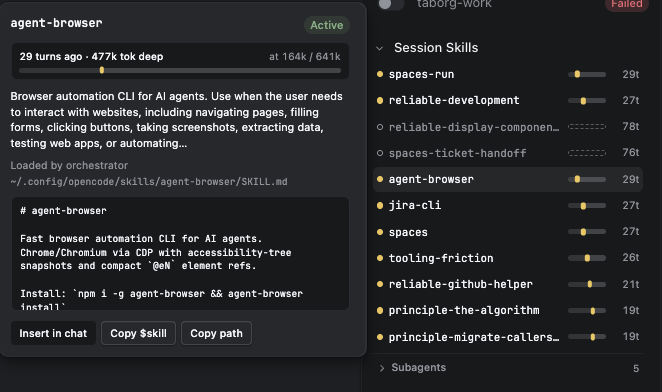

# Session Skills extension for OpenChamber

Displays skills activated in the current OpenChamber session and its child subagents inside the **Work Status** panel, with a live context-window depth indicator, turn age, and quick actions (requires OpenChamber `>=2.7.0`).

## Setup

1. Build the extension if you have not already (`bun install && bun run build`).
2. Open **Settings → Extensions** in OpenChamber and add the `session-skills` directory.
3. Approve and enable the extension. Once active, the **Session Skills** section appears in **Work Status** and updates automatically as skills are attached or loaded.

## What appears in Work Status



### Main session skills

Each skill activated via `$skill` in your prompt or loaded by an agent appears as a row showing `[dot] [skill-id] [context bar] [turn age]`:

- **Status & freshness dot**:
  - **Green**: active skill in the current context window.
  - **Amber**: skill sits `>= 100k` tokens deep in the active context window.
  - **Pulsing blue**: skill tool call is currently loading.
  - **Red**: skill failed to load (row displays `failed`).
  - **Hollow muted dot**: skill was evicted by a completed session compaction.
- **Context-window bar**: plots where the skill's latest activation sits inside the active prompt window (left = earlier/deeper in context, right = active prompt tip). Falls back to turn ratio when token counts are not yet available, and renders as a dashed empty bar after compaction.
- **Turn age**: `now` for the current turn (or loading), `1t` / `3t` for earlier turns, or `failed` on errors.

### Subagent skills

Skills loaded inside child subagent sessions (or handed off via `subagent` / `task` tool calls) are grouped under a collapsible **Subagent · `<agent>`** (or **Subagents** when multiple actors are present) header with a total count. Each row plots its position inside the child subagent's own context window alongside its main-session turn age.

### Skill details & quick actions

Hovering, focusing, or clicking a row opens a detail popover (or expands an inline detail card when popovers are unavailable) showing:

- Status badge (`Active`, `Loading`, `Failed`, or `Compacted`) and any load error message.
- Exact context depth and token readout (for example `2 turns ago · 164k tok deep` and `at 36.5k / 200.5k`, or `This turn · at context tip`).
- Skill description and a preview of `SKILL.md` instructions.
- Provenance (`Attached in prompt ($skill)`, `Loaded by <agent>`, `Subagent (<actor>)`, activation count) and `SKILL.md` path.
- Quick action buttons:
  - **Insert in chat**: appends `$<skill-id> ` into the OpenChamber composer.
  - **Copy $skill**: copies `$<skill-id>` to the clipboard.
  - **Copy path**: copies the full `SKILL.md` path to the clipboard (when the skill directory is known).

## Development

```bash
bun install
bun run build
bun run typecheck
bun run check
bun test
```

## License

MIT — see [LICENSE](./LICENSE).
